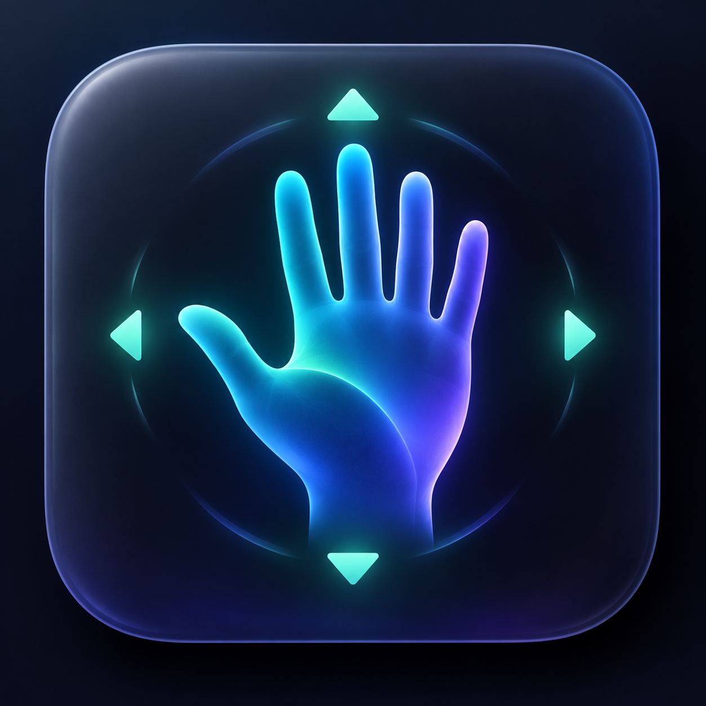
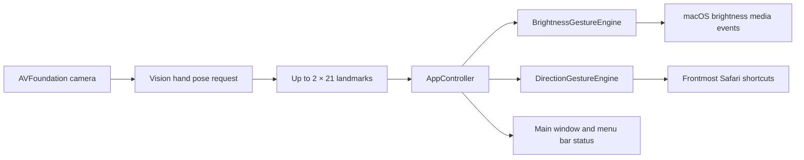

<p align="center">
  
</p>

<h1 align="center">PHNTM</h1>

<p align="center">
  A native macOS utility for controlling Safari and display brightness with deliberate two-hand gestures.
</p>

<p align="center">
  macOS 14+ · SwiftUI · AVFoundation · Vision · No third-party dependencies
</p>

## Overview

PHNTM watches the camera locally, recognizes up to two hands with Apple Vision, and turns stable hand poses into macOS input events. Directional commands require an open safety palm and a pointing command hand. Display dimming requires an explicit sequence of two open palms followed by two fists.

The application does not require swiping, does not record video, and does not send camera data over the network.

## Features

- Native SwiftUI macOS application with a menu bar status indicator.
- On-device two-hand pose recognition using Vision hand landmarks.
- Previous and next Safari tab commands.
- Page Up and Page Down commands in frontmost Safari.
- Deliberate two-palms-to-two-fists gesture that dims the display to one step above minimum.
- Stabilization and release/rearm logic to prevent repeated or accidental commands.
- Live camera preview with a hand skeleton and landmark count.
- English first-run onboarding for Camera and Accessibility permissions.
- Local and public DMG packaging scripts.
- Universal Release builds for Apple silicon and Intel Macs.

## Gestures

### Safari commands

Keep one hand open as the safety signal. With the other hand, hold a pointing pose in one direction.

| Command hand | Result |
| --- | --- |
| Point left | Previous Safari tab |
| Point right | Next Safari tab |
| Point up | Scroll the page down |
| Point down | Scroll the page up |

Safari must be the active frontmost application, and **Control Safari** must be enabled in PHNTM.

### Display brightness

1. Show two open palms and hold them until PHNTM reports that both palms are ready.
2. Close both hands into fists.
3. PHNTM lowers brightness to one macOS step above minimum.
4. Release the fists before repeating the gesture.

The brightness gesture remains active when Safari control is disabled. It works with displays that respond to the standard macOS brightness controls.

See [Gesture recognition](docs/GESTURES.md) for thresholds, state transitions, and recognition guidance.

## Requirements

- macOS 14 or later.
- A built-in or connected camera.
- Camera permission.
- Accessibility permission for posting Safari shortcuts and brightness events.
- Safari for browser commands.
- A display controllable through standard macOS brightness keys for the dimming command.

## Installation

### Signed release

For distribution, install a signed and notarized PHNTM DMG produced by the release workflow:

1. Open the DMG.
2. Drag **PHNTM** to **Applications**.
3. Launch PHNTM from Applications.
4. Complete the Camera and Accessibility onboarding.

Keep the application in the same location after granting Accessibility permission. Replacing, moving, or rebuilding an unsigned copy can cause macOS to treat it as a different application.

### Build from source

```bash
git clone https://github.com/arsenysmorodin/PHNTM.git
cd PHNTM
open PHNTM.xcodeproj
```

Select the **PHNTM** scheme and run the macOS target. The project has no package-manager dependencies.

Command-line Debug build:

```bash
env DEVELOPER_DIR=/Applications/Xcode.app/Contents/Developer \
  xcodebuild \
  -project PHNTM.xcodeproj \
  -scheme PHNTM \
  -configuration Debug \
  -destination 'platform=macOS' \
  -derivedDataPath /tmp/PHNTM-DerivedData \
  CODE_SIGNING_ALLOWED=NO \
  build
```

Unsigned command-line builds are useful for compilation checks, but a consistently signed application is recommended for real Accessibility testing.

## First run

PHNTM presents a three-step setup guide:

1. Review the supported gestures.
2. Grant Camera access.
3. Grant Accessibility access in **System Settings → Privacy & Security → Accessibility**.

After both permissions are available, choose **Start Using PHNTM**. The camera can later be started or stopped from either the main window or the menu bar.

## Menu bar states

The menu bar icon reflects the current runtime state:

| State | Meaning |
| --- | --- |
| Permission required | Camera or Accessibility is missing |
| Ready | PHNTM can recognize gestures |
| Open palm detected | The Safari safety hand is ready |
| Two palms detected | Close both hands to trigger dimming |
| Gesture detected | A Safari direction was recognized |
| Brightness recognized | The display dimming gesture fired |
| Error | Camera, Vision, permission, or event posting failed |

## Architecture



Recognition is intentionally ordered: the brightness sequence owns both hands while active, so intermediate closing frames cannot become Safari commands.

Read [Architecture](docs/ARCHITECTURE.md) for component responsibilities, threading, data flow, and state ownership.

## Privacy and security

- Camera frames are processed locally by AVFoundation and Vision.
- PHNTM does not save images or video.
- PHNTM contains no networking code, telemetry, analytics, or cloud service integration.
- Only onboarding completion and the Safari-control toggle are stored in `UserDefaults`.
- Accessibility is used only to post the documented Safari shortcuts and brightness media-key events.
- The public Release configuration enables Hardened Runtime.

See [Permissions and privacy](docs/PERMISSIONS_AND_PRIVACY.md) for the complete permission model.

## Documentation

- [Architecture](docs/ARCHITECTURE.md)
- [Gesture recognition](docs/GESTURES.md)
- [Permissions and privacy](docs/PERMISSIONS_AND_PRIVACY.md)
- [Development and verification](docs/DEVELOPMENT.md)
- [Troubleshooting](docs/TROUBLESHOOTING.md)
- [Distribution and notarization](DISTRIBUTION.md)
- [Contributing](CONTRIBUTING.md)
- [Security policy](SECURITY.md)
- [Changelog](CHANGELOG.md)

## Current limitations

- Browser commands support Safari only.
- Safari must be frontmost when a browser command is triggered.
- Recognition quality depends on lighting, camera framing, hand visibility, and Vision landmark confidence.
- Brightness control depends on the display accepting standard macOS brightness events; many external monitors do not.
- The repository currently has no XCTest target. Builds and gesture behavior are verified with compilation checks and a manual test matrix.

## Distribution

Create an ad-hoc local test DMG:

```bash
./scripts/package-local.sh
```

Maintainers with a Developer ID Application certificate and configured notarization credentials can create a public release:

```bash
./scripts/package-release.sh
```

Do not publish the local ad-hoc DMG. See [Distribution](DISTRIBUTION.md) for signing, notarization, checksums, versioning, and the release checklist.

## License

No open-source license is currently included. Copyright © 2026 Arseny Smorodin. All rights reserved.
