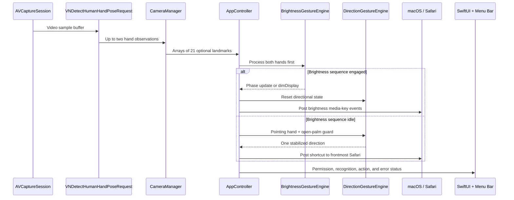

# Architecture

PHNTM is a native macOS application built entirely with Apple frameworks. It has no backend, database, network client, browser extension, or third-party runtime dependency.

## Runtime data flow



## Components

### Application lifecycle

`PHNTMApp` creates one `AppStatusStore` and one `AppController` for the entire process. The same controller is shared by the main SwiftUI window and `MenuBarExtra`, so gesture recognition can remain active when the main window is closed.

`AppController` owns all runtime services:

- `CameraManager`
- `DirectionGestureEngine`
- `BrightnessGestureEngine`
- `BrowserTabController`
- `DisplayBrightnessController`
- `AppStatusStore`

It binds their observable state, resolves gesture priority, dispatches actions, and translates errors into user-visible status.

### Camera and Vision

`CameraManager` configures an `AVCaptureSession` with the default video camera and a medium session preset. It uses:

- a serial session queue for capture-session configuration and start/stop work;
- a serial frame queue for sample-buffer processing;
- `alwaysDiscardsLateVideoFrames` to avoid backlog;
- an analysis rate limited to approximately 12 frames per second;
- `VNDetectHumanHandPoseRequest` with `maximumHandCount = 2`.

Each recognized hand is converted into a fixed array of 21 optional `CGPoint` landmarks in this order:

1. wrist;
2. four thumb joints;
3. four index-finger joints;
4. four middle-finger joints;
5. four ring-finger joints;
6. four little-finger joints.

A landmark is kept when Vision confidence is greater than `0.3`. Missing or low-confidence landmarks remain `nil`, allowing classifiers to reject incomplete poses without crashing.

Published UI state is marshalled back to the main actor.

### Pose classification

`GestureClassifier` contains stateless geometric checks:

- `isOpenPalm` requires all four non-thumb fingers to be extended;
- `isPointing` requires the index finger to be extended and allows at most one ambiguous non-index finger;
- `isFist` requires at least three confidently curled non-thumb fingers and rejects any extended finger;
- `twoHandGesture` pairs a pointing hand with a different open-palm hand.

Finger extension uses the angle at the PIP joint and a scale-relative segment-length check. Fist recognition additionally compares fingertip positions with the wrist, PIP joints, and palm size.

### Directional gesture state machine

`DirectionGestureEngine` converts a static pointing pose into one of four `GestureDirection` values.

Key properties:

- the pose must remain stable for `0.18` seconds;
- direction must be clearly horizontal or vertical using a `1.35` axis ratio;
- pointing length must exceed an absolute and palm-relative minimum;
- one pose produces one event;
- another event is blocked until the pointing pose is released for `0.18` seconds.

The open palm is a guard signal. Losing it resets a candidate that has not yet fired, but it does not bypass the release requirement after an event.

### Brightness gesture state machine

`BrightnessGestureEngine` is a deliberate sequence rather than a one-frame classifier:

```text
idle → arming → readyToClose → closing → waitingForRelease → idle
```

Two open palms must stabilize first. Both hands must then become fists within the transition window and remain fists long enough to fire one `dimDisplay` event. The engine cannot fire again until the fists are released.

While this engine is in any engaged phase, `AppController` resets and suppresses directional recognition. This explicit ownership prevents closing fingers from being interpreted as a Safari pointing command.

### Safari output

`BrowserTabController` performs three checks before posting an event:

1. Accessibility event-posting permission is available.
2. The frontmost application has bundle identifier `com.apple.Safari`.
3. Safari is active and not terminated.

It then posts key-down and key-up `CGEvent` pairs directly to Safari's process:

| Gesture | Posted command |
| --- | --- |
| Left | Control-Shift-Tab |
| Right | Control-Tab |
| Up | Page Down |
| Down | Page Up |

Direct process targeting reduces the chance of sending a command to another application if focus changes between validation and event posting.

### Display output

`DisplayBrightnessController` posts standard macOS system-defined brightness media-key events through the HID event tap. It sends enough brightness-down steps to reach the lower bound, then one brightness-up step so the display remains visible.

The controller rejects concurrent adjustments and verifies Accessibility event-posting permission immediately before acting.

### Status and presentation

`AppStatusStore` provides a single priority-ordered status for the menu bar and menu:

1. missing permission;
2. persistent error;
3. transient action/error;
4. brightness gesture armed;
5. open safety palm detected;
6. ready.

`ContentView` displays the camera preview, hand count, landmark count, pose status, last action, Safari toggle, permission state, and camera control.

`CameraPreviewView` is an `NSView` backed by `AVCaptureVideoPreviewLayer` plus Core Animation shape layers for skeleton lines and recognized joints.

`OnboardingView` is a non-dismissible three-step setup flow. Completion and the Safari-control toggle are stored in `UserDefaults` through `AppStorageKeys`.

## Main-actor and queue boundaries

- Observable application services are isolated to `@MainActor`.
- Capture-session mutation stays on `sessionQueue`.
- Vision processing stays on `frameQueue`.
- `AVCaptureSession`, output, and Vision request references are explicitly treated as queue-confined unsafe nonisolated values.
- Published state returns to the main actor through `DispatchQueue.main.async`.
- Display dimming runs as an asynchronous main-actor task so short delays between media-key events do not block recognition callbacks.

## Error propagation

Camera setup and Vision errors are published by `CameraManager`. Output controllers return failure or throw localized errors. `AppController` sends these into `AppStatusStore`, which distinguishes persistent errors from transient action failures.

The application intentionally provides visible state at every stage instead of silently swallowing recognition or permission failures.

## Project layout

```text
PHNTM/
├── Artwork/                         Master application icon
├── PHNTM.xcodeproj/                 Xcode project
├── PHNTM/
│   ├── Browser/                     Safari event controller
│   ├── Camera/                      AVFoundation and Vision pipeline
│   ├── Gestures/                    Classifiers and state machines
│   ├── Status/                      App and menu bar status
│   ├── System/                      Display brightness output
│   ├── Views/                       Camera preview and onboarding
│   ├── AppController.swift          Runtime orchestration
│   ├── ContentView.swift            Main window
│   ├── PHNTMApp.swift               Application scenes
│   └── PHNTM.entitlements           Camera entitlement
├── docs/                            Detailed documentation
├── scripts/                         Local and public packaging
└── DISTRIBUTION.md                  Signing and notarization guide
```
